# GURJYOT SINGH
### Cloud • DevOps • Automation • AI

Building practical cloud-native projects, automating workflows, and learning by shipping.

---

## THE PROFILE, IN MOTION

<!-- SVG cards are generated daily by .github/workflows/profile-activity.yml -->

## THREE THINGS I LIKE TO BUILD

<table>
<tr>
<td width="33%" valign="top">

### 01 / BUILD
**Cloud infrastructure**

Deployments, containers, serverless systems, CI/CD pipelines, and reliable infrastructure.
</td>
<td width="33%" valign="top">

### 02 / AUTOMATE
**DevOps workflows**

Making repetitive work predictable with Python, Linux, GitHub Actions, Docker, and infrastructure automation.
</td>
<td width="33%" valign="top">

### 03 / EXPLORE
**AI-powered tools**

Experimenting with AI services, practical automation, and useful developer-focused applications.
</td>
</tr>
</table>

## SELECTED BUILDS

| Project | What it explores | Stack |
|---|---|---|
| **Serverless Identity Verification Pipeline** | Event-driven identity and image-processing workflow using managed AWS services. | AWS Lambda · Step Functions · Rekognition · S3 · DynamoDB · SNS |
| **AutoScale Shop** | Containerized microservices e-commerce application with an automated delivery workflow. | Python · Flask · Docker · Kubernetes · CI/CD |
| **TalentFlow** | A project focused on streamlining recruitment and talent workflows. | See repository |
| **Minecraft Infrastructure & DevOps Platform** | Infrastructure and automation experiments around a Minecraft server platform. | DevOps · Automation |

## TOOLBOX

**Cloud & infrastructure:** AWS, Azure, EC2, S3, IAM, Lambda, API Gateway, DynamoDB, CloudFront, Elastic Beanstalk

**DevOps & automation:** Docker, Kubernetes, Jenkins, GitHub Actions, Terraform, Ansible, CI/CD, Linux

**Development & data:** Python, SQL, JavaScript, Flask, Node.js, MongoDB, MySQL

## CERTIFICATIONS & LEARNING

- AWS Certified AI Practitioner
- AWS Academy Cloud Foundations
- Red Hat Linux Automation with Ansible
- Google Cloud Foundations
- GitHub Professional Certificate
- Docker Foundations
- Microsoft Azure AI Fundamentals

## A LITTLE MORE ABOUT ME

- 🎓 MCA graduate — Cloud Computing & DevOps
- ☁️ Interested in cloud engineering, DevOps, platform engineering, and automation.
- 🧪 I enjoy turning cloud concepts into hands-on projects.
- 📍 India

## LET'S CONNECT

If you're working on cloud, DevOps, automation, or interesting developer tools, I'd be happy to connect.

  <a href="https://www.linkedin.com/in/gurjyot-singh-gurz/">LinkedIn</a> ·
  <a href="https://gurjyot-gurz.github.io/Tech-Portfolio/">Portfolio</a> ·
  <a href="mailto:sgurjyot740@gmail.com">Email</a> ·
  <a href="https://github.com/Gurjyot-gurz">GitHub</a>

Paper-and-ink visuals, electric-blue accents, and live GitHub contribution data. Refreshed daily by GitHub Actions.

